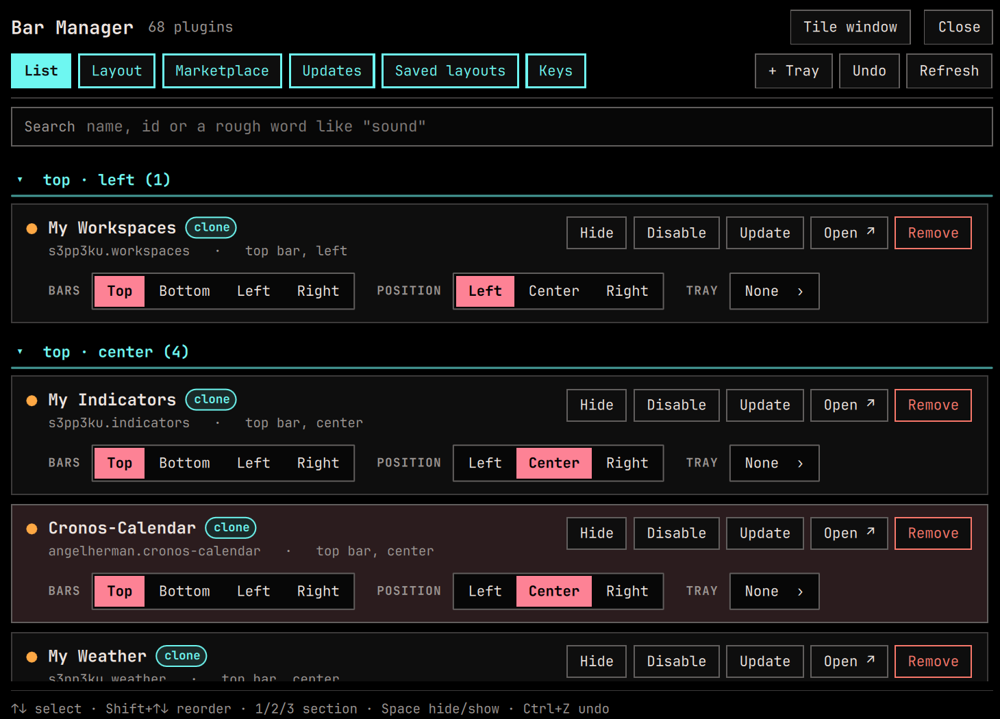

# Omarchy Bar Manager



One panel to control which plugins appear in your [Omarchy](https://omarchy.org) bar, so you don't have to hand-edit `shell.json` or run a string of `omarchy plugin ...` commands every time you want to change something.

For every bar plugin you get:

| Action | What it does |
|---|---|
| **Hide / Show** | Take a widget off the bar but **keep it installed and enabled**, then put it back in the same spot later. |
| **Enable / Disable** | Turn a plugin on or off. |
| **Update** | Preview a git-installed plugin update, then apply its exact reviewed commit. |
| **Open ↗** | Open the plugin's folder. |
| **Remove** | Uninstall a plugin entirely. Turns red and asks "Sure?" before it does anything. |

Built-in Omarchy plugins can be hidden, shown, enabled and disabled; update and uninstall are only offered for plugins you installed.

## Why

Omarchy's CLI can enable, disable and remove plugins, but has no "take it off the bar, but keep it" command, and widgets can live in different places (a bar section, or hosted inside a tray plugin). This tool handles both, shows what is actually on your bar right now, and does it from a clickable list.

## Features

- **Live status** for every bar widget: a colored dot (green on a bar, yellow disabled, grey off every bar), where it sits in plain words ("top bar, left" or "inside t2"), and badges for built-in, clone, tray and update available.
- **Hide without uninstalling**, with the original position remembered so **Show** restores it.
- **Smart search**: finds plugins by name, id, category, aliases and description, understands everyday words (`sound` finds Audio, `wifi` finds Network, `cpu` finds System monitor) and tolerates small typos (`blutooth`).
- **Duplicate cleanup**: removes repeated tray entries that cause doubled icons, automatically on every change (or `barctl fix`).
- **Safe edits**: before every change to `shell.json` a backup is saved as `shell.json.bak.barctl-<timestamp>` (last five are kept).
- **Readable on every theme**: colors come from your current Omarchy theme and are checked for contrast, so OLED-black and bright themes stay legible (see *Readable on every theme* below).
- **Every bar**: works with the main bar and with [Extra Bars](https://github.com/s3pp3ku/omarchy-extra-bars). View tabs (List, Layout, Marketplace, Updates, Saved layouts, Keys) are outlined in a second theme accent and sit apart from the one-off actions (+ Tray, Undo, Refresh).

Each plugin is a card with labeled **Bars**, **Position** and **Tray** button groups under its name, for installed or not-yet-shown plugins alike. The Bars buttons are toggles: click each bar you want, so one plugin can sit on several bars at once. For the Tray plugin the main bar gets the real Tray and every other bar gets one of its own built-in trays. Removing an extra bar remembers its widgets, so adding it back restores them. Moving the main bar to an edge that already has a bar swaps the two, so nothing is lost.
- **Service widgets placed correctly**: widgets that ship a background service (e.g. Keylight) are put directly on a bar, never inside the tray, where they would be invisible.
- **Layout screen**: the `Layout` button draws all four bars as they sit on the screen (top and bottom spanning the width, sides between them), every widget as a small icon chip. The icons are the ones the widgets really draw: opening the screen makes Extra Bars load each widget for a moment and report its glyph (or, for widgets that draw an SVG or canvas, a picture of it), cached in `~/.cache/barctl-icons-live.json`; a code scan and a short fallback table fill any gaps, and letters are the last resort. Hover a chip for its name and plugin id, trays with their members inside. Every section is a grid of numbered cells with one spare cell at the end, and while you drag, a marker and a `#N` badge show the exact cell the widget will take. On a side bar the cells run strictly top to bottom, in one column, matching the real order of the widgets on screen (a top/bottom bar still wraps left to right into more rows as needed). The screen scrolls instead of squashing anything if the window is narrower than the bars need. `omarchy-shell shell summon s3pp3ku.bar-manager '{"view":"layout"}'` opens it straight into this screen. Drag a chip to any slot (a marker shows exactly where it lands, between two chips or at the end), drop it on a tray to put it inside, drag a tray by its header to move it with everything in it, or click `+L`/`+R`/... to add a missing bar. It works from the config files, so it covers the main bar's own widgets too, with exact placement, which live dragging on the bar cannot.
- **Trays**: `+ Tray` opens a small form: pick the bar and section, and it tells you exactly where the new tray goes (and if that bar will be created) before you click **Add tray**. The main bar is greyed out there, since it keeps its trays in the Tray plugin. A widget's **Tray** button puts it into a tray and cycles through them; trays move between bars and sections with the same buttons. Each tray card lists what it holds, and deleting one names it (**Delete t1**), asks again, and lists the widgets that will move onto the bar. **Undo** brings the tray back with everything in it.
- **Side bars**: a side bar's sections are top, middle and bottom, and the Position buttons relabel themselves to match. Extra-bars supports dragging widgets between sections and bars.
- **Scriptable**: everything the panel does is available from the terminal via `bin/barctl`.

## Requirements

- Omarchy with the shell plugin system (`omarchy plugin`, `omarchy-shell`)
- `jq`

## Hover descriptions

Every control — the header buttons, the status dot, a plugin's name (its full description, if it has one), the Bars/Position/Tray buttons and their captions, and every action button — shows a short tooltip on hover explaining what it does.

## Install

```sh
omarchy plugin add https://github.com/s3pp3ku/omarchy-bar-manager.git --enable --yes
```

Enabling it adds a small sliders icon to the right side of your bar. Click it to open the manager, or bind a key:

```sh
omarchy-shell shell toggle s3pp3ku.bar-manager '{}'
```

Press **Esc** to close the panel.

To remove it:

```sh
omarchy plugin remove s3pp3ku.bar-manager --yes
```

## Command line

```sh
bin/barctl list                  # JSON of every bar widget and its state
bin/barctl hide <plugin-id>      # off the bar, still installed
bin/barctl show <plugin-id>      # back on the bar where it was
bin/barctl enable <plugin-id>
bin/barctl disable <plugin-id>   # also takes it off the bar
bin/barctl check-updates <plugin-id>   # or: check-updates --all
bin/barctl apply-update <preview-token>
bin/barctl uninstall <plugin-id>
bin/barctl place <plugin-id> <top|bottom|left|right> [left|center|right]
bin/barctl togglebar <top|bottom|left|right>   # add/remove an empty extra bar
bin/barctl mainpos <top|bottom|left|right>     # move the main bar (an extra bar there swaps places)
bin/barctl swapbars <edge> <edge>              # swap any two bars (main or extra) between edges, widgets stay with their bar
bin/barctl addtray <edge|auto> [section]        # new empty tray on an extra bar
bin/barctl intray <plugin-id> <tray-id>        # put a widget in a tray (place takes it back out)
bin/barctl rmtray <tray-id>                    # remove a tray; its widgets stay on the bar
bin/barctl drop <plugin-id> <edge> <section> [before-id]   # what drag and drop uses; side bars accept top/middle/bottom
bin/barctl toggle <plugin-id> <edge> [section]   # add it to / remove it from one bar, others untouched
bin/barctl setsection <plugin-id> <section>    # same section on every bar it is on
bin/barctl fix                   # drop duplicate tray entries
```

Use `OMARCHY_SHELL_JSON=/path/to/copy.json` to try changes against a copy of your config instead of the real one.

## How it works

`barctl` is a small bash + `jq` script over the real Omarchy commands and `~/.config/omarchy/shell.json`. Top-level bar widgets are removed from `bar.layout`; widgets hosted inside a tray plugin are removed from that tray's widget list. Where each hidden widget lived is stored in `~/.local/state/barctl-hidden.json` so **Show** can put it back. The panel (`Panel.qml`) is only a front end that calls `barctl`.

## Notes

- The compositor may size the window narrower than requested; the layout is built for roughly 560px and up.
- Tested on Omarchy with a tray plugin hosting several widgets; layouts with other container plugins may behave differently. Issues and pull requests welcome.

## License

MIT

## Settings are remembered

Taking a plugin off the main bar remembers its entry (the Tray's widget list, a clock's format and so on) in `~/.local/state/barctl-removed-main-entries.json`, and putting it back restores it.

## Layouts and Undo

**Layouts** saves named arrangements of all four bars, extra-bar trays, inline widget settings, enabled bar-widget entries, and the remembered hidden widgets and removed bars. Restoring takes two clicks and saves the current layout first. Uninstalled plugins are skipped, and Bar Manager stays accessible. Idle settings, unrelated services, and the active bar implementation are preserved.

Every layout mutation through `barctl` records a snapshot before it starts. **Undo** restores the previous arrangement; the newest 30 snapshots appear in Layouts. Undo restores layout and settings, not uninstalled plugin files or plugin updates. Layout changes made through other tools are not automatically added to this history.

Named layouts, history, update previews and panel position are stored in `$XDG_STATE_HOME/bar-manager` (normally `~/.local/state/bar-manager`). Configuration writes follow symlinks and retain permissions. Commands are serialized so two Bar Manager operations cannot write concurrently.

## Grouped list and keyboard controls

The list follows the actual widget order, grouped by bar, section, and tray. Click a heading to fold it; searching shows matching entries inside folded groups. Widgets on multiple bars appear in each relevant group. The Available group contains widgets currently off every bar. Selection, search, folded groups, view and scroll position are remembered.

Click a row, then:

| Key | Action |
| --- | --- |
| Up / Down | Select a widget |
| Shift + Up / Down | Reorder within its section or tray |
| Shift + Left / Right | Change section on the selected bar |
| 1 / 2 / 3 | Move to the start, center or end section |
| Alt + T / B / L / R | Move to the top, bottom, left or right bar |
| Space | Hide or show the widget |
| Ctrl + Z | Undo a layout change |
| Ctrl + F | Focus search |
| Escape | Cancel a pending restore, or close |

Moving sections preserves widget settings and affects the selected bar occurrence. The existing bar toggles can still place one widget on several bars. The panel reopens after its own changes rebuild the shell.

## Reviewed updates and plugin shortcuts

**Updates** and each row's **Update** button fetch a preview with commit summaries and change statistics. **Apply** installs exactly the displayed commit. Plugins with local changes (including untracked files), linked directories, detached checkouts or divergent histories are skipped. The installation is checked again immediately before applying; failed manifest validation rolls the update back. Reviewed updates are marked in the plugin list.

**Marketplace → Install from URL** accepts an HTTPS or SSH Git URL. Each plugin's **Open ↗** button opens its source folder. Built-in plugins and clones have distinct labels.

## Additional commands

```sh
bin/barctl save-layout 'Gaming'
bin/barctl snapshots
bin/barctl restore-layout saved <snapshot-id>
bin/barctl undo
bin/barctl reorder <plugin-id> <edge> <section> <-1|1> [tray-id]
bin/barctl move-section <plugin-id> <edge> <section>
bin/barctl check-updates --all
bin/barctl apply-update <preview-token>
bin/barctl add-plugin <git-url>
```

These additions were informed by [Omaseiton](https://github.com/p-clements/omaseiton)'s layout snapshots, keyboard interaction, remembered cursor and reviewed updates, adapted for Extra Bars and Bar Manager's trays.

## 1.2: Marketplace and shortcuts

The Marketplace tab browses the catalog with search, installed/available/verified filters, screenshots, license and verification metadata, source links and a two-click install review. Choose destination bar and section before installing. Current repository versions are installed; registry verification can refer to an older commit. Manual-setup listings are viewable but not installed automatically. Catalog results are cached for offline use.

Keys assigns plugin launch shortcuts, checks live Hyprland conflicts, and preserves existing keybindings. Saved bindings have Bar Manager ownership markers; reload errors restore the previous file. Omaplug-owned bindings stay under Omaplug management.

## Readable on every theme

Bar Manager reads your theme's whole palette (`colors.toml`, in either the `red`/`green`/... or `color0`–`color15` form) and builds its colors from it:

- **Main accent** for selected rows and the options that are switched on.
- **Second accent** for the view tabs, group headings and badges: the theme color whose hue is furthest from the main accent (blues, magentas, cyans and orange first, so green, yellow and red stay free for status).
- **Status colors** from the theme's green, yellow and red: on a bar, disabled or update available, and destructive buttons.

Every text and border color is pushed toward black or white until it clears a minimum contrast with the background (main text 7:1, secondary text 4.6:1, borders and accents 3:1). Checked against all 22 stock Omarchy themes, including OLED black ones (Vantablack, Hackerman) and light ones (White, Flexoki Light, Catppuccin Latte). Colors update when you change theme.

The Marketplace uses the same outlined cards, button groups and filled primary **Install** button as the List.

Narrow windows: tabs wrap, the Bars/Position/Tray groups wrap under each plugin's name, and marketplace details open with a Back to plugins button.

Four-bar layout previews grow to fit top and bottom widget sections and scroll when needed.
